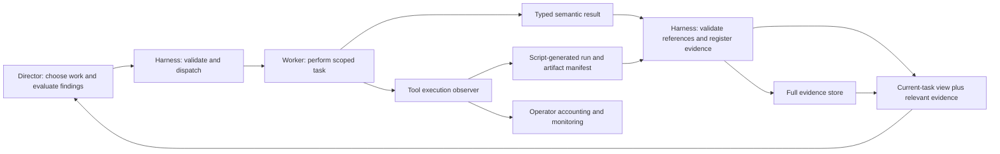

# Foreman run findings: accounting, tokens, prompts, delegation and execution

Scope: the fresh-allowance run beginning November 8 at 23:11 EST and ending November 9 at 14:15 EST. Read-only investigation of Foreman source, actual stored director prompts/responses, 1,562 recorded parent-worker model steps, the OpenCode SQLite session store, model metadata, and official OpenCode/OpenRouter sources. No new paid model experiments, model/config changes, implementation edits or budget resets were performed.


## Reader context and review contract

This document is a self-contained case study for [Foreman fixes PR #3](https://github.com/JPrier/Foreman/pull/3). It records an investigation, not a claim that all recommended fixes are implemented.

Foreman is the Python harness exposed locally as `smart-coder`. It asks a director model for JSON decisions, dispatches OpenCode worker sessions, stores task state/reports, validates evidence against a requirements ledger, and enforces a local USD allowance. This run used Windows with PowerShell, OpenCode 1.19.5, an OpenRouter GPT-6.1 Sol director via OpenCode, and GLM-5.3 Flash workers. An independent local supervisor inspected the run approximately every 20 minutes.

The downstream task was to implement the full compositional behavior-engine design in [JPrier/IRL PR #9](https://github.com/JPrier/IRL/pull/9). Labels I6a/I6b mean autonomous-planner and world-integration increments; I7 means emergent-quest APIs; I8 means formal-verification/audit integration; I9–I11 mean generated evaluation, liveness and legacy migration. These labels are work-plan increments, not individual model calls.

All wall-clock times in prose/tables are Eastern Standard Time (UTC−05:00); evidence timestamps retain UTC. The complete task began November 6, but the detailed token investigation concerns the last fresh-allowance resumption, November 8 at 23:11 through November 9 at 14:15. The earlier assignment inventory is included for context; its costs must not be added to the latest allowance a second time.

The user explicitly requires **all script-owned controls to stay in scripts/operator reporting, outside director and worker prompts**. This includes budgets, accounting, allowance resets, process monitoring and operational enforcement. The user also rejects blanket elapsed-time limits: waiting for a legitimately active proof, build or CI run can be correct. Recommendations below preserve both constraints.

### Findings index and implementation status

| ID | Finding | Confidence | Status at audited PR head `da550bd` |
|---|---|---|---|
| F01 | OpenCode-calculated costs mislabeled as authoritative reported provider costs | Source and arithmetic confirmed | Unfixed |
| F02 | Nested worker sessions omitted from Foreman parent ledger | Session-tree records confirmed | Unfixed |
| F03 | Raw accounting histories dominate director context | Actual stored prompts measured | Projection fix exists; audited live process still used older loaded code |
| F04 | First-4k report truncation omits important evidence and causes retrieval round trips | All ten reports and eight retrieval decisions measured | Unfixed |
| F05 | Director has zero recorded cache reads; both changing prefixes and same-prefix misses occur | Usage and prompt comparisons confirmed; root cause incomplete | Unresolved |
| F06 | Director manually transcribes evidence/ledger state, causing paid validation retries | Decisions and rejection events confirmed | Partly mitigated by existing retry handling; typed manifests not implemented |
| F07 | Long worker sessions repeatedly process growing contexts | Token events confirmed | Unfixed |
| F08 | Some earlier verification workers could not run tests in plan mode | Worker reports confirmed | Recent reviews use build-capable workers; reusable verification role not implemented |
| F09 | Repeated ad hoc proof/CI scripting adds friction; one long proof rerun changed no source | Tool timeline confirmed; exact avoidable share uncertain | Unfixed |
| F10 | Routine/medium/high routing maps to the same worker model | Effective configuration and recorded model IDs confirmed | Configuration observation, not automatically a defect |
| F11 | Source updates do not update already loaded coordinator code or retrospectively clean saved context | Process/session chronology confirmed | Safe restart/context migration still needs a general protocol |
| F12 | Supervisor liveness reports obscured the long proof trajectory; its costs are outside task accounting | Monitoring artifacts and separate process confirmed | Unfixed visibility/scope issue; cadence itself was authorized |

### Evidence and uncertainty rules

The committed [evidence.json](evidence.json) contains all 18 director measurements, all ten worker aggregates, all 37 assignment timestamps, the local pricing snapshot and nested-session deltas. [worker-steps.jsonl](worker-steps.jsonl) contains every one of the 1,562 parent-worker step token/cost records. Run `python docs/findings/2026-11-09-smart-coder/verify.py` from the repository root to reproduce the arithmetic offline.

These are sanitized extracts, not private session transcripts. They contain no credentials, raw reasoning text, full prompts, tool outputs, private database files or user-specific filesystem paths. The source state snapshot hash is retained for provenance; that hash alone does not let an external reader independently verify the private snapshot. Reviewers can reproduce all cost sums and aggregate projections from committed measurements, but semantic code correctness and detailed activity classification remain attributed to the investigation/worker evidence. An independent fresh audit of private transcripts is not claimed.

## Main conclusions

1. Ten workers were ten multi-step agent sessions, not ten model requests. They made 1,562 recorded model steps and repeatedly processed growing conversations.
2. The director delegated execution adequately. Eight dispatch decisions started ten workers; eight decisions fetched reports, one asked about a stale budget, and one was rejected by ledger validation. Excessive repeated context and bookkeeping, rather than failure to delegate coding, dominated director costs.
3. Raw worker accounting histories were repeatedly included in director prompts. Removing operator fields from the actual stored packets cuts their serialized size by 51–55%, before any task-evidence compaction.
4. Worker summaries were simply the first 4,000 characters of final reports. All ten reports were longer than that. This routinely omitted evidence near the end and forced full-report retrieval.
5. Workers had substantial general tooling. Better reusable evidence/proof/CI helpers and a build-capable verification role would address specific friction; adding more generic tools is not the main remedy.
6. Structured worker results would help if they separate concise semantic outcomes from a script-produced evidence manifest. JSON alone, especially a complete transcript serialized as JSON, would not solve the problem.
7. Foreman's dollar totals need an accounting correction: the OpenCode step cost is calculated from local model metadata. It is not an independently reconciled OpenRouter invoice amount. Two nested sessions also fall outside Foreman's recorded parent-worker costs.

## Cost provenance and reconciliation limits

Foreman takes OpenCode `step_finish.part.cost`, sums it in `run_opencode`, and classifies the result as reported cost. OpenCode v1.19.5 `Session.getUsage()` calculates that field from normalized tokens times model-catalog prices. For this OpenRouter path it does not use a returned OpenRouter usage.cost or generation.total_cost. See [exact-version source](https://github.com/anomalyco/opencode/blob/v1.19.5/packages/opencode/src/session/session.ts).

There is also misleading route metadata: `OpenCodeDirector.call()` initially sets `subscription=true` and `cost_tracking=unavailable` even when its model ID selects the metered OpenRouter route. Those labels are not proof of subscription routing or free usage. The selected model, actual provider, measured tokens, cost-calculation source and authoritative billing source must be separate fields.

Accordingly, $7.2696718855 and $13.3882885 below are **reproducible local accounted amounts**, not confirmed provider debits. Actual invoice reconciliation requires provider generation identifiers and authoritative per-generation usage/cost records, which this Foreman path discards or does not capture. [OpenRouter exposes a generation-metadata endpoint](https://openrouter.ai/docs/api/api-reference/generations/get-request-&-usage-metadata-for-a-generation), but generation identifiers were not available in these saved accounting records.

The cached OpenCode model catalog uses worker rates of $0.0335/M uncached input, $0.03/M cached input, and $0.083/M generated tokens. Every recorded worker step cost matches those rates to floating-point precision. At inspection time the public OpenRouter model catalog instead advertises $0.15/M input, $0.03/M cached input and $0.50/M completion for the same model ID. Applying today's advertised rates to historical tokens would give about $9.28, but that is a counterfactual, not a recovered historical bill. Provider routing, historical rates and token normalization must be reconciled before treating either figure as the charged total. [Current model catalog](https://openrouter.ai/api/v1/models).

OpenCode's cached director metadata includes both a 272k context tier and a legacy `context_over_200k` tier. Its exact-version cost routine falls back to the legacy over-200k tier when the newer tier does not match. The recorded calls precisely follow that fallback: ten lower-tier and eight higher-tier calls, despite the largest recorded prompt being about 223k tokens. The fallback adds $4.40 compared with pricing the same recorded tokens at the lower tier. This is a tracker behavior, not evidence OpenRouter actually overcharged $4.40.

## Why ten workers accounted for $7.27

| Token category, summed across model steps | Tokens | Local accounted cost |
|---|---:|---:|
| Uncached input | 14,460,695 | $0.4844 |
| Cached input read | 223,989,504 | $6.7197 |
| Output plus reasoning | 789,801 | $0.0656 |
| Total | — | $7.2697 |

These are cumulative tokens processed over 1,562 model steps, not a single 224-million-token conversation. Cached reads constitute 93.94% of input volume and 92.43% of the locally calculated worker cost. Generating the reports or reasoning was not the main dollar component.

The largest workers were I8 proofs ($2.74, 453 steps) and I6b integration ($2.29, 356 steps), together about 69.2% of parent-worker costs. A focused repair acceptance cost only $0.063. Average cost per worker obscures that large variation.

I6b and I8 contexts ended at approximately 317k and 315k input tokens. Every subsequent model step revisits substantial existing context, even when most tokens are cached. Workers used tools extensively and carried the resulting conversation forward; cheap per-token pricing does not make hundreds of large cached requests free.

I8 alone recorded 11.92M uncached input tokens, 82.5% of all parent-worker uncached input. Forty-four of its steps recorded zero cache reads, accounting for 10.38M uncached tokens. Some occurred after long solver/polling waits, but others occurred only seconds apart. Cache expiry, routing and prefix behavior are plausible contributors; the available records do not establish a single cause. It would be incorrect to blame all misses on waiting or claim a shorter wait would fix them.

OpenCode's default compaction is oriented toward context overflow, not an optimal task handoff or cost threshold. Its local model metadata permits roughly a million tokens. These 315–317k sessions therefore continued growing without a forced compacted checkpoint. The I8 database session contains no compaction parts. That explains why a large supported context could still be inefficient. Any compaction change must preserve evidence, assumptions and unfinished requirements. [Official compaction behavior](https://opencode.ai/docs/compaction/).

### Nested worker accounting gap

I6b launched two OpenCode explore subagents. Their separate SQLite sessions account for $0.0633096685 and $0.115839599, totaling $0.1791492675. Foreman records the parent session only; its $7.27 excludes these child-session costs. Actual provider cost, other maintenance calls and the external 20-minute monitor are not reconciled by this parent ledger. Delegation costs need an explicit session tree with deduplication, not an assumption that parent costs already include children.

## Why eighteen director calls accounted for $13.39

| Recorded token category | Tokens | Local accounted cost |
|---|---:|---:|
| Normal input | 54 | $0.000156 |
| Cache writes | 3,418,278 | $12.828413 |
| Cache reads | 0 | $0 |
| Output plus reasoning | 44,253 | $0.559720 |
| Total | — | $13.388289 |

The category called cache-write is normalized input usage; it is not an additional copy of ordinary input and must not be double-counted. All eighteen calls reported zero cache reads. About 95.8% of the accounted director cost was processing/writing input, not generating complex plans.

Actual stored prompt packets show:

| Packet | JSON characters | Raw worker usage-history characters | Without operator fields |
|---|---:|---:|---:|
| First | 395,664 | 197,711 | 191,361 |
| Last | 594,343 | 313,556 | 271,993 |

System text and runtime wrappers explain differences from Foreman's context_chars field. The measured projection removes usage, cost, model and duration fields from event objects, not requirements or evidence. It does not include additional savings from suppressing operator-only warning notes. The existing prompt-boundary patch addresses much of this, but the audited live process had loaded the older builder.

There is additional duplication after telemetry is removed: complete historical worker summaries, assignment catalogs, a large ledger including resolved evidence, full requested reports, and director memory recounting many of the same facts. The last packet's ledger was 72,265 characters. At the end, even stripping operator fields leaves roughly 272k characters. A typed current-task view plus selective evidence retrieval is still needed.

### Caching diagnosis

Foreman starts a new OpenCode session for every director call and rebuilds a monolithic context packet. A new session does not by itself prove that cross-request provider caching cannot work. However, the actual zero-hit result is clear.

Frequently changing director memory occurs early in the JSON, before most reusable material. After dispatches, consecutive actual requests diverged after only about 6.8k characters. Conversely, the ledger-rejection retry shared about 598.6k prefix characters and still recorded no cache reads. Thus prefix ordering is a real design concern, but it cannot explain all observed misses. Stable provider routing/cache keys, TTLs, adapter token normalization and actual provider usage need measurement. [OpenRouter's caching guide](https://openrouter.ai/docs/guides/best-practices/prompt-caching).

The practical priority is to avoid sending unnecessary data even before caching. Caching an irrelevant giant prompt is still an inferior boundary to not constructing it.

## Is the director delegating enough?

For execution, yes: it has no tools, and workers did the repository work, testing, research, GitHub delivery and CI inspection. In the latest window there were eight dispatch decisions, eight report-retrieval decisions, one stale-budget ask-user decision and one ledger-rejected decision. Eight dispatches produced ten top-level workers; I6b additionally used two nested explorers.

The problem is that the director also performs expensive data transcription and orchestration bookkeeping. Its last response serialized roughly 6.5k characters of ledger updates, 4.9k of assignment details and 4.4k of memory. Output cost was relatively small, but these repeated objects grow future inputs and introduce path/hash mistakes. Scripts should register artifacts, compute hashes/fingerprints, validate report schemas and maintain canonical references; the director should judge findings and choose the next substantive work.

Adding more workers is not a general cure: each starts with about 13.3–13.8k input tokens, learns the repository and often repeats verification. Carefully scoped proof-specialist help or a checkpoint after an unproductive large attempt could have helped I8, but splitting every action would add handoff overhead. Shared-tree mutations need serialization. The current routine/medium/high worker settings all map to the same GLM model, so difficulty escalation did not change model capability in this run.

## Do workers lack tools?

No broad capability gap is visible. They used shell, reads, searches, writes/edits, web fetching, nested tasks, Cargo, Git/GitHub CLI, WSL and Kani. The longest worker made 508 tool invocations. Several complex shell/Powershell/Bash quoting failures and repeated ad hoc helper scripts are visible, but they do not show that filesystem, testing or networking tools were absent.

Specific gaps worth fixing:

- A reusable proof runner with per-harness logs, exit status and progress/process identity. It should preserve valid long-running work and expose when a new attempt changes the proof problem; it should not impose a blanket timeout.
- A canonical CI query that distinguishes relevant Actions runs, legacy statuses and unrelated queued integrations. The worker should not rebuild this interpretation every time.
- Script-generated evidence manifests covering command invocation, completion, logs, exact code state, paths and hashes. Passing schema validation alone is not proof that a test actually ran or that the code is correct.
- A verification role that permits build/temp artifacts and isolated negative-test worktrees while restricting production-source edits. Older plan-mode reviews could not run tests; the recent execution reviews were correctly build-capable.
- Workers should retain exact references to specification sections and existing accepted reports, while retrieving only relevant source slices rather than repeatedly dumping broad files.

Recorded command occurrences are diagnostic, not proof of waste: I6b issued 13 commands containing `cargo test --workspace`, 29 containing `gh`, and four fingerprint commands. Some reruns followed real fixes. A cache of command results is safe only when its code/environment fingerprint and test scope remain valid; a cheap prior pass cannot replace required independent acceptance.

## Should workers return structured responses?

Yes. Today they return prose and Foreman slices `full_output[:4000]`. Every recent full report was between about 6.8k and 17.3k characters, so every summary was truncated. Detailed findings and artifact hashes commonly appear later. Eight director retrieval calls accounted for $5.49 locally; retrieving evidence was justified, repeatedly resending the giant surrounding context was not.

`opencode run --format json` provides a JSON event stream. It does not enforce a worker-report schema. OpenCode v1.19.5 separately supports a `json_schema` structured-output contract in its prompt API; Foreman's CLI path does not use that mechanism. [Exact-version prompt implementation](https://github.com/anomalyco/opencode/blob/v1.19.5/packages/opencode/src/session/prompt.ts).

A useful boundary has three parts:

1. **Worker semantic result:** concise outcome, completed requirement IDs, findings, unresolved blockers, limitations, requested next action and evidence references.
2. **Script-owned manifest:** actual command/run records, code fingerprints, artifact paths/hashes, delivery metadata and worker identity. These are collected and validated in code, not regenerated by the director or assigned as bookkeeping in model prompts.
3. **Evidence store:** full reports and logs remain available by stable IDs; the director gets the current result and relevant ledger delta, and requests precise evidence only when needed.

Illustrative semantic response, not a proposed model budget instruction:

```json
{
  "status": "partial",
  "outcome": "Six production-bound proof harnesses verified; two remain blocked.",
  "completed_requirements": ["T6.1", "T6.3", "T6.7", "T6.8"],
  "blockers": [
    {"requirement": "T6.2", "reason": "Claim-path proof remains intractable", "evidence_id": "run-claim-final"},
    {"requirement": "T6.4", "reason": "Replay-path proof remains intractable", "evidence_id": "run-replay-final"}
  ],
  "evidence_ids": ["workspace-final", "proof-six-final", "delivery-checkpoint"],
  "next_action": "independent_review"
}
```

The harness validates references and hydrates relevant verified metadata. A declared requirement status is a worker claim until appropriately reviewed. Preserve original user requirements and unresolved scope in durable storage; do not solve context bloat by silently dropping them. Invalid output needs a focused same-session repair with a bounded retry policy, not a full new implementation assignment.

Giving the director a narrowly scoped report-reading tool can improve selective access, but tool retrieval still needs a model request/response round trip. It does not make eight retrieval calls free. Supplying a complete concise result and manifest proactively can avoid many routine fetches; difficult reviews still need fuller evidence.

## Recommended implementation order

1. Correct cost provenance and reconcile provider records; include nested sessions with deduplication. Keep this entirely in scripts/operator reporting.
2. Verify that the existing operator-field projection is active, then replace the complete-history packet with a deterministic current-task view and relevant evidence references.
3. Introduce typed worker results and script-generated evidence manifests; eliminate first-4k prose truncation and repeated path/hash transcription.
4. Measure and repair director caching/routing with stable prefixes and keys. Do not assume persistent sessions or a different model alone will fix it.
5. Add proof/CI/evidence helpers and checkpoint-based work boundaries; evaluate worker context compaction while preserving useful long waits and exact evidence.
6. Only then evaluate worker sizing, role/model routing and the need for a proof specialist against recorded quality and cost. More delegation is not the first fix for this trace.

The next implementation should be evaluated with saved-prompt replay first, then a small authorized live trial comparing billed cost, tokens, cache hits, retrieval count, ledger errors, requirement retention and correctness. No exact savings percentage is claimed from character reductions alone.

## Per-worker measurements

Parent sessions only; costs are OpenCode-calculated. Counts are summed across steps.

| Worker | Steps | Uncached input | Cached input | Generated incl. reasoning | Accounted USD | Full report chars |
|---|---:|---:|---:|---:|---:|---:|
| review_I6a_repaired_checkpoint | 150 | 332,149 | 14,691,392 | 67,001 | 0.4574 | 9,434 |
| implement_I6b_world_integration | 356 | 976,749 | 74,857,600 | 161,657 | 2.2919 | 8,625 |
| review_I6b_world_checkpoint | 138 | 139,010 | 15,971,584 | 84,928 | 0.4909 | 14,632 |
| repair_I6b_window_cooldown | 100 | 245,294 | 9,734,144 | 68,304 | 0.3059 | 6,805 |
| map_remaining_design_acceptance | 29 | 171,814 | 2,207,808 | 22,251 | 0.0738 | 17,293 |
| review_I6b_cooldown_repair_acceptance | 36 | 167,097 | 1,853,952 | 21,235 | 0.0630 | 8,262 |
| resolve_observer_and_action_contract_policy | 53 | 93,410 | 3,367,552 | 36,453 | 0.1072 | 12,622 |
| implement_I7_emergent_quests | 165 | 325,905 | 18,428,992 | 87,125 | 0.5710 | 7,296 |
| review_I7_production_acceptance | 82 | 86,225 | 5,427,904 | 34,201 | 0.1686 | 11,184 |
| implement_I8_production_formal_gates | 453 | 11,923,042 | 77,448,576 | 206,646 | 2.7400 | 9,729 |


## Latest resumption: complete work map

| EST interval | Work | Duration | Outcome / assessment |
|---|---|---:|---|
| Nov 8 23:11–23:13 | Resume, stale budget question, retrieve prior report | ~2m | Avoidable stale-context question, then legitimate continuation |
| 23:13–23:31 | Independent I6a repair acceptance | 18.3m | Verified fairness, sanctions, neutral self-transfers, reconsideration and attribution repairs |
| 23:32–Nov 9 01:24 | I6b world integration | 111.6m | Scarcity/wages, faction reports, offscreen catch-up, autonomous retellings, one-shot hardening, mutation audit; runner compatibility correction |
| 01:25–01:46 | Independent I6b review | 21.7m | Accepted six scopes; reproduced duplicate actions after event-window overflow |
| 01:48–02:14 | Focused duplicate-action repair | 26.2m | Bounded cooldown fix, committed and pushed |
| 02:14–02:22 | Map remaining requirements | 8.6m | Useful scope mapping; sequential after repair despite sharing a dispatch |
| 02:24–02:30 | Independent repair acceptance | 6.1m | Accepted cooldown repair |
| 02:30–02:39 | Resolve observer/action-contract scope | 9.4m | Separated genuine parser/observer requirements from proposed extensions |
| 02:40–03:16 | I7 emergent-quest implementation | 35.7m | Narrative APIs and evaluation; runtime hook still absent |
| 03:17–03:24 | Independent I7 acceptance | 6.5m | Accepted bounded API checkpoint, recorded integration/audience gaps |
| 03:25–03:26 | Ledger rejection and corrected decision | <1m | Invalid evidence path/hash submission; recovered next call |
| 03:26–14:15 | I8 proof kernels, audit, properties and CI | 648.8m | Dominant elapsed-time bottleneck; six of eight proof harnesses verified |

## I8: where the 10h49 went

| EST interval | Observed work | Assessment |
|---|---|---|
| 03:26–03:50 | Read requirements/source, install Kani in existing WSL, author proof/audit/property scaffolding, fix compilation | Mostly expected implementation/setup |
| ~03:50–05:19 | Whole-package Kani run, 5,400 seconds, output buffered through tail, no output returned | Poor observability; duration alone does not prove waste |
| 05:19–06:51 | Repeat whole-package Kani run, 5,500 seconds; no source edits between the runs; shell tool eventually timed out | Strongest elapsed-time waste signal: another ~92m without changing the proof problem, only output capture |
| 06:51–~08:04 | Move to Linux filesystem, run individual harnesses, repair real assertion/unwind issues, retry corroboration | Mixed useful debugging and repeated expensive attempts; transfer/deal proofs begin passing |
| ~08:04–09:23 | Smaller diagnostic probes, unwind variations, formatting/maps/unrolling isolation | Useful diagnosis, reached after hours of large runs; some temporary shell-script errors |
| 09:25–~10:40 | Extract exact production numeric functions, update proof harnesses and audit | Productive architectural change; six proofs become tractable |
| ~10:40–12:51 | Modify and retry claim-acceptance/replay heap paths, monitor CPU/memory; eventually capture bounded blocker attempts | Legitimate feasibility exploration mixed with diminishing returns; two properties remain unproved |
| 12:51–13:19 | Final proof run, tests, WASM, audit evidence and first commit | Appropriate validation, but first checkpoint came almost ten hours after assignment began |
| 13:19–14:02 | Push and PR update, workflow-name repair, actual Actions execution and one rerun per push/PR run | Real CI needed to complete; not all waiting was spurious |
| 14:02–14:12 | Poll legacy pending status/null Claude suite after relevant Actions runs passed | About ten minutes of low-value status confusion, not the principal cause of the long run |
| 14:12–14:15 | Final PR body, remote evidence and report | Appropriate wrap-up |

I8 recorded 508 tool calls: 337 bash, 121 edit, 38 write, 11 read, one webfetch. Tool-reported elapsed durations sum to 9.51 hours; this is not CPU time or a clean idle-time measure. Sixty-four commands contain sleep, frequently while a solver was actively using CPU. Eight CI-oriented sleep commands total about 42.8 minutes, including necessary active CI waits. Do not treat all of these as wasted.

The two whole-package attempts total 181.7 minutes. The unchanged repeat is strongly avoidable from the record; the exact useful share of the first attempt is uncertain. Later smaller probes were not all identical retries: they varied bounds, isolated code, and eventually motivated production-core extraction.

I8's final report states: two commits, six of eight Kani harnesses verified locally and in hosted CI, two heap-heavy acceptance/replay proofs blocked, 491 workspace tests passing/six ignored, 11 scenarios, executable negative audit gates and a deliberately broken-conservation counterexample. This audit checked live hosted job results but did not independently rerun tests/proofs or accept I8 correctness.


## Complete 37-assignment inventory

These are all top-level assignments in the saved task, including earlier allowance windows. Times below are UTC so readers can cross-check the machine-readable evidence without a timezone database. Durations are per worker; parallel work must not be summed as wall-clock time. The historical phase-2 timeout duration does not necessarily capture all later recovered orphan execution. Reported outcomes are scoped worker/reviewer findings, not a new correctness review.

| # | Assignment | Start UTC | Minutes | Accounted USD | Outcome |
|---:|---|---|---:|---:|---|
| 1 | `discover_design_repo` | 2026-11-06T05:29:17 | 2.7 | 0.0228 | Located design and correct repository; detected stale local branch. |
| 2 | `plan_full_engine` | 2026-11-07T05:02:40 | 15.0 | 0.0427 | Prepared branch and authored implementation plan/test spec; captured baseline. |
| 3 | `implement_engine_foundation` | 2026-11-07T05:18:12 | 29.4 | 1.0645 | Implemented domain schema, persistence and evidence/epistemic foundation. |
| 4 | `review_engine_plan` | 2026-11-07T05:47:34 | 1.9 | 0.0120 | Found plan omissions in formal CI, requirement coverage and liveness criteria. |
| 5 | `correct_engine_plan` | 2026-11-07T05:50:27 | 5.1 | 0.0587 | Corrected plan/spec without reimplementing the delivered foundation. |
| 6 | `verify_engine_foundation` | 2026-11-07T05:55:30 | 4.9 | 0.1456 | Found nine concrete foundation defects for repair. |
| 7 | `review_corrected_engine_plan` | 2026-11-07T06:01:39 | 2.2 | 0.0093 | Accepted corrected planning documents; implementation remained open. |
| 8 | `repair_foundation_findings` | 2026-11-07T06:03:48 | 12.0 | 0.3177 | Repaired the nine foundation findings. |
| 9 | `verify_foundation_repairs` | 2026-11-07T06:26:39 | 5.3 | 0.0450 | Statically accepted repairs but could not independently execute tests in plan mode. |
| 10 | `execute_foundation_acceptance_gate` | 2026-11-07T06:32:47 | 2.9 | 0.0236 | Executed foundation acceptance gates in a separate build-capable worker. |
| 11 | `implement_phase2_goals_contracts` | 2026-11-07T06:37:19 | 30.1 | 1.6481 | Implemented deals, goals, intentions and bargaining; timed-out accounting later recovered. |
| 12 | `review_recovered_phase2` | 2026-11-07T15:35:45 | 4.5 | 0.1129 | Reviewed recovered phase-2 work; identified custody, cancellation and intention-wiring defects. |
| 13 | `repair_phase2_review_findings` | 2026-11-07T15:41:28 | 23.5 | 0.3395 | Repaired five phase-2 findings with production regression coverage. |
| 14 | `verify_phase2_repairs` | 2026-11-07T16:05:42 | 5.1 | 0.0705 | Statically checked repairs; plan-mode constraints required separate test execution. |
| 15 | `discover_formal_execution_route` | 2026-11-07T16:05:42 | 2.2 | 0.0160 | Researched a viable formal-verification execution/CI route. |
| 16 | `execute_phase2_repair_acceptance` | 2026-11-07T16:11:51 | 1.4 | 0.0215 | Executed phase-2 repair acceptance gates. |
| 17 | `implement_phase3_contextual_minds` | 2026-11-07T16:14:08 | 29.6 | 1.2396 | Implemented contextual relationships, needs, emotions and related utility integration. |
| 18 | `review_phase3_integrated_acceptance` | 2026-11-07T16:44:50 | 2.8 | 0.0274 | Reviewed phase-3 integration; required a contextual gift/payment repair. |
| 19 | `implement_phase3_D1_and_phase4_mechanics` | 2026-11-07T17:01:35 | 24.7 | 1.2247 | Repaired contextual gift/payment effects and added phase-4 mechanics. |
| 20 | `review_checkpoint_D1_I5_current` | 2026-11-07T18:40:03 | 6.3 | 0.1643 | Accepted bounded mechanics checkpoint; found privacy/contextual-breach defects. |
| 21 | `repair_query_privacy_contextual_breaches` | 2026-11-07T18:47:17 | 26.5 | 0.7038 | Repaired query disclosure and contextual-breach handling; committed and updated PR. |
| 22 | `review_privacy_breach_checkpoint` | 2026-11-07T19:14:32 | 5.5 | 0.1111 | Accepted those repairs; discovered real web CI failures and inaccurate all-green reporting. |
| 23 | `repair_web_save_version_checkpoint` | 2026-11-07T19:21:24 | 17.9 | 0.0691 | Fixed stale save-version browser expectation and corrected PR reporting. |
| 24 | `review_web_checkpoint_delivery` | 2026-11-07T19:40:03 | 1.5 | 0.0176 | Independently accepted web repair and remote browser delivery. |
| 25 | `implement_I6a_autonomous_planner` | 2026-11-07T19:42:31 | 62.0 | 1.9634 | Implemented autonomous planning, priorities and candidate dispatch. |
| 26 | `review_I6a_production_checkpoint` | 2026-11-07T20:45:22 | 17.8 | 0.2425 | Reproduced starvation, repeated sanctions, self-transfer effects and reconsideration defects. |
| 27 | `repair_I6a_acceptance_defects` | 2026-11-07T21:04:06 | 40.5 | 0.8102 | Repaired four planner defects and pending-decision attribution; committed/pushed. |
| 28 | `review_I6a_repaired_checkpoint` | 2026-11-09T04:13:19 | 18.3 | 0.4574 | Independently accepted the prior planner repairs. |
| 29 | `implement_I6b_world_integration` | 2026-11-09T04:32:47 | 111.6 | 2.2919 | Implemented world integration and corrected runner compatibility. |
| 30 | `review_I6b_world_checkpoint` | 2026-11-09T06:25:17 | 21.7 | 0.4909 | Accepted six world scopes; reproduced repeated actions after event-window overflow. |
| 31 | `repair_I6b_window_cooldown` | 2026-11-09T06:48:07 | 26.2 | 0.3059 | Fixed one-shot retirement cooldown and corrected wear-event documentation. |
| 32 | `map_remaining_design_acceptance` | 2026-11-09T07:14:18 | 8.6 | 0.0738 | Mapped outstanding design, integration and acceptance scope. |
| 33 | `review_I6b_cooldown_repair_acceptance` | 2026-11-09T07:24:02 | 6.1 | 0.0630 | Independently accepted focused cooldown repair. |
| 34 | `resolve_observer_and_action_contract_policy` | 2026-11-09T07:30:10 | 9.4 | 0.1072 | Resolved observer/action-contract requirement questions; identified actual missing work. |
| 35 | `implement_I7_emergent_quests` | 2026-11-09T07:40:58 | 35.7 | 0.5710 | Implemented bounded emergent-quest APIs and additive evaluation. |
| 36 | `review_I7_production_acceptance` | 2026-11-09T08:17:40 | 6.5 | 0.1686 | Independently accepted APIs; recorded missing runtime integration/audience guards. |
| 37 | `implement_I8_production_formal_gates` | 2026-11-09T08:26:21 | 648.8 | 2.7400 | Delivered formal-proof/audit checkpoint: six proofs pass, two blocked; no independent acceptance yet. |

## All 18 director calls in the latest resumption

| ID | Completed UTC | Next decision | Normal input | Cache write | Cache read | Output + reasoning | Accounted USD | Packet chars → without operator fields |
|---|---|---|---:|---:|---:|---:|---:|---|
| D01 | 2026-11-09T04:11:53 | ask_user | 3 | 150,766 | 0 | 1,293 | 0.389851 | 395,664 → 191,361 |
| D02 | 2026-11-09T04:12:52 | retrieval | 3 | 150,891 | 0 | 1,712 | 0.394354 | 396,478 → 192,175 |
| D03 | 2026-11-09T04:13:19 | dispatch | 3 | 153,635 | 0 | 2,080 | 0.404894 | 404,897 → 200,594 |
| D04 | 2026-11-09T04:31:58 | retrieval | 3 | 158,886 | 0 | 1,513 | 0.412351 | 417,417 → 197,206 |
| D05 | 2026-11-09T04:32:47 | dispatch | 3 | 161,991 | 0 | 4,653 | 0.451514 | 427,204 → 206,993 |
| D06 | 2026-11-09T06:24:45 | retrieval | 3 | 177,616 | 0 | 1,284 | 0.456886 | 465,857 → 208,495 |
| D07 | 2026-11-09T06:25:17 | dispatch | 3 | 180,655 | 0 | 2,124 | 0.472884 | 475,233 → 217,871 |
| D08 | 2026-11-09T06:47:17 | retrieval | 3 | 185,198 | 0 | 1,106 | 0.474061 | 486,047 → 214,052 |
| D09 | 2026-11-09T06:48:07 | dispatch | 3 | 190,130 | 0 | 3,739 | 0.512721 | 501,130 → 229,135 |
| D10 | 2026-11-09T07:23:17 | retrieval | 3 | 195,423 | 0 | 1,311 | 0.501673 | 514,543 → 228,355 |
| D11 | 2026-11-09T07:24:01 | dispatch | 3 | 202,553 | 0 | 3,410 | 1.063927 | 539,154 → 252,966 |
| D12 | 2026-11-09T07:39:54 | retrieval | 3 | 203,609 | 0 | 1,224 | 1.036417 | 539,399 → 243,190 |
| D13 | 2026-11-09T07:40:58 | dispatch | 3 | 209,993 | 0 | 5,073 | 1.126072 | 560,802 → 264,593 |
| D14 | 2026-11-09T08:17:02 | retrieval | 3 | 214,276 | 0 | 1,480 | 1.093592 | 568,681 → 255,094 |
| D15 | 2026-11-09T08:17:40 | dispatch | 3 | 216,802 | 0 | 2,397 | 1.119977 | 576,223 → 262,636 |
| D16 | 2026-11-09T08:24:27 | retrieval | 3 | 219,485 | 0 | 1,349 | 1.117672 | 582,553 → 260,203 |
| D17 | 2026-11-09T08:25:25 | ledger_rejected | 3 | 223,145 | 0 | 4,430 | 1.182187 | 594,016 → 271,666 |
| D18 | 2026-11-09T08:26:21 | dispatch | 3 | 223,224 | 0 | 4,075 | 1.177257 | 594,343 → 271,993 |

## Proposed design: keep decisions in models and execution records in scripts



This is a proposal, not the current implementation. Accounting is an operator-only branch of the flow. Model requests contain task outcomes, unresolved requirements, meaningful findings and authorized work scope; they do not contain spending instructions, allowance arithmetic or instructions to perform controls already enforced by scripts.

### Report and evidence contracts

The semantic worker result should have a versioned schema and explicit `complete`, `partial`, `blocked` or `failed` status. It should identify which requirements were addressed, why blockers remain, which findings are confirmed versus hypotheses, and which evidence IDs support each claim. A result claiming six bounded proofs must not imply that all eight proofs or the entire downstream design are complete. Preserve skips, ignored tests, incomplete CI and scoped acceptance explicitly.

The script-generated manifest should record an execution ID, owning worker/session tree, actual command and exit, completion state, timestamps, captured log ID and digest, repository state before/after, artifact references, and delivery observations. It must distinguish a process that is active, one that exited, a model claiming success, a successful command, and an independently accepted requirement. For commands launched outside an observed tool path, mark provenance weaker rather than fabricate script verification.

For example, the director may cite `evidence_id=proof-six-final`. The harness resolves that ID to the canonical manifest and checks its association with the exact code state. The director does not retype absolute paths, SHA-256 strings and repository tuples. Fingerprints detect state identity; they do not independently prove that a command ran against that state or that a test is adequate. Maintain the current independent-review requirement when justified.

A native response schema should constrain the final worker result; `--format json` on the CLI is only transport framing. The selected installed OpenCode version has a structured-output path in its prompt API, but integrating that path requires an adapter and failure handling. Where a schema cannot be enforced by the provider, validate locally and request a focused repair of the same result/session. Track the repair separately from a new implementation assignment. No unlimited format-repair loop is proposed.

### Current-task context rather than an expanding transcript

Always retain original user requirements and corrections in durable state. Build the director's view deterministically from the authoritative requirement graph, current unresolved work, new result(s), relevant code-state invalidations, and precise references to older evidence. Completed unrelated summaries, cost histories, old dispatch payloads and repeated catalog entries stay in storage.

Recent meaningful outcomes must include the evidence needed for the immediate next decision. This can prevent a routine request-full-report decision before every review, but some decisions legitimately need more detail. Provide bounded, selectively scoped access by result/evidence ID and sections. Native read tools improve ergonomics; they still require a model round trip and are not free. An automatic fetch of the latest typed result/manifest can be script-driven; deciding which additional semantic evidence is relevant remains a director judgment.

Do not globally redact words such as `budget`, `cost` or dollar amounts: this downstream simulation itself has faction/resource budgets, and other user projects may explicitly involve financial requirements. Separate operator metadata by typed origin/audience. The existing `_task_event` projection is only one boundary: operator guidance already copied into saved follow-ups, director memory, ledger text or report prose needs an explicit, auditable migration of known injections. Archive the original record, preserve task scope/evidence, and do not claim a field-level projection retrospectively erased all historical text.

### Cache investigation and experiments

The baseline is eighteen recorded zero-read director requests. Preserve request/generation correlation, provider identity, model version, route, token categories, cache key/TTL and authoritative cost when available. Distinguish a provider cache miss from adapter normalization or local price-table behavior. Some near-identical requests missed too, so moving memory later is not a proven complete fix.

Compare a stable static prefix plus appended task deltas with the current rebuilt packet. Do not assume reusing a session automatically fixes caching: replaying all history can also increase costs. The direct OpenRouter director backend already exists, but switching to it is a separate, explicitly evaluated routing choice, not a prerequisite for shrinking irrelevant context. First replay saved packets offline to verify requirement/evidence retention; any live experiment requires its own finite operator-approved allocation and reports actual usage separately.

Worker context management should use stable handoff checkpoints and exact evidence references where useful. A supported million-token context is not a requirement to keep 300k tokens live indefinitely. Conversely, forced summarization can lose a critical proof assumption or unresolved finding. Evaluate compaction/handoff by task completion and correctness, not token reduction alone. Cache-read tokens are cheaper in many routes but still have a cost; this run's normalized cached counts are cumulative across hundreds of steps.

### Proof and CI helpers without a blanket timeout

A proof runner should expose per-harness identity, source/assumption/bound changes, log location, process identity, exit status and genuine progress evidence. Separate an unchanged rerun from a changed proof problem. A long active solver can deserve more time; high CPU alone does not establish eventual progress or justify endless identical retries. Record enough observations for a reasoned checkpoint or blocker report, rather than having a model repeatedly reconstruct process state with shell commands.

A CI helper should correlate commit, workflow, event, run attempt and required check policy. Report active relevant runs separately from legacy status contexts and unrelated integrations. In this case, both relevant Actions runs passed while a zero-record legacy status and a queued Claude suite remained pending. Correct handling is to identify and disclose that distinction, not wait for every integration indiscriminately or declare all possible checks successful.

Build/verification workers need permission to create build artifacts and isolated adversarial probes while preserving production-source changes. A blanket plan-mode restriction caused redundant handoffs earlier. Verification should stay independent where required; reuse a prior command result only if its exact state, environment and scope remain applicable.

### Safe deployment of harness fixes

The observed coordinator was launched before the prompt-boundary patch and kept its already loaded functions for the entire run. Commit/push success is not proof a live process uses that commit. Record runtime code revision and effective sanitized configuration at launch and show them in operator status.

A general safe handoff could request a pause after the current assignment is completely recorded, release the task lock, archive/migrate known operator-only context, and resume the same saved task under the updated harness. Do not kill an active worker merely to refresh code, duplicate a coordinator, blindly replay interrupted mutations, reset the allowance during a code update, or silently alter models. This protocol remains proposed; the local case-specific cleanup helper is not a general production feature.

Monitoring should report last useful task/tool progress, current work and verification scope, newly delivered commits, repeated root causes and pending blockers. A living process is only liveness evidence. The 20-minute supervisor cadence was authorized, so this audit does not call its existence wasteful. Its separate model/tool costs should be attributed to an operator monitoring category rather than disappear from total session spend.

## Implementation acceptance and evaluation plan

| Area | Required evidence before calling it fixed |
|---|---|
| Cost provenance | Source-tagged token estimates versus authoritative costs; controlled reconciliation against generation records; historical rates retained; no duplicate counting of normalized cache fields |
| Tier handling | Boundary cases around both 200k and 272k; explicit precedence for modern and legacy catalog fields; a local estimate is never labeled a provider debit |
| Nested sessions | Parent plus two children reproduces $0.1791492675 extra here; repeated import is idempotent; descendants are attributed once; missing child usage is explicitly incomplete |
| Context view | Replay all 18 stored views: required original/corrected scope and relevant evidence remain; operator telemetry is absent; unrelated historical outcomes are stored, not blindly repeated |
| Worker result schema | All ten fixture results retain findings, blockers and manifest references beyond the old 4k prefix; malformed output produces a focused repair or explicit failure |
| Evidence registration | Exact paths/hashes/code-state records generated and checked by scripts; invalid or stale references rejected; no weakening of independent acceptance or mutation invalidation |
| Caching | Matched measured calls, provider routes and token categories; compare cache hits and billed/estimated costs separately; no assumption that a new client/session fixes misses |
| Worker role/tooling | Build-capable verification can execute necessary tests and isolated probes while preserving tracked source; proof/CI helpers distinguish useful waiting from identical retries |
| Safe update | Existing worker completes once, result/accounting persists, old coordinator exits, same task resumes under recorded new revision; allowance/history unchanged |
| Monitoring | Reports useful progress and real stalls separately; monitor cost scope explicit; no blanket elapsed-time kill policy |

After offline regression replay, compare a small authorized live trial with the baseline: authoritative charges where available, local estimates, input/output/cache token counts, retrieval calls, ledger rejections, independent review findings, requirement retention, completed scope, time to recover a checkpoint and total wall time. Cheaper output that misses requirements is a regression. Character-count reductions are not an exact promise of token, dollar or elapsed-time savings.

## Source map for maintainers

| Code/source | Why it matters |
|---|---|
| [Foreman backend adapter](../../../smart_harness/backends.py) | New OpenCode process per call; sums local step cost; worker report instructions; `full_output[:max_report_chars]`; no typed final-result schema |
| [Foreman engine](../../../smart_harness/engine.py) | Calls director with unbounded context (`None`); records usage/costs; dispatches/routs workers; enforces allowances; rejects invalid evidence then retries |
| [Director contracts and projection](../../../smart_harness/contracts.py) | Current `_task_event` removes operator fields; view still includes history/catalogs/ledger; schema and retrieval contract |
| [Evidence ledger](../../../smart_harness/ledger.py) | Exact report-string path/hash checks, original/follow-up preservation, stale/superseded evidence and outstanding requirements |
| [Configuration](../../../smart_harness/config.py) | 4k summary default; same default model for routine/medium/high; shared USD allowance |
| [Regression fixture](../../../tests/test_force_continue.py) | Existing refresh checks and operator-field prompt boundary; does not establish complete structured-result or provider billing fixes |
| [OpenCode v1.19.5 usage calculation](https://github.com/anomalyco/opencode/blob/v1.19.5/packages/opencode/src/session/session.ts) | Token normalization, model-price multiplication, modern tier selection then legacy fallback |
| [OpenCode v1.19.5 provider metadata](https://github.com/anomalyco/opencode/blob/v1.19.5/packages/opencode/src/provider/provider.ts) | Catalog price conversion, including both tier representations |
| [OpenCode v1.19.5 prompt processing](https://github.com/anomalyco/opencode/blob/v1.19.5/packages/opencode/src/session/prompt.ts) | Structured-output path distinct from CLI event JSON |
| [OpenCode v1.19.5 CLI](https://github.com/anomalyco/opencode/blob/v1.19.5/packages/opencode/src/cli/cmd/run.ts) | Actual session/event transport behavior for this installed version |
| [OpenCode v1.19.5 compaction](https://github.com/anomalyco/opencode/blob/v1.19.5/packages/opencode/src/session/compaction.ts) | Version-specific compaction/pruning implementation; current online docs can differ |

## Reproduction and limitations

Run from the repository root:

```sh
python docs/findings/2026-11-09-smart-coder/verify.py
```

The verifier uses Python's standard library, makes no network/model calls, checks all 1,562 step records, reconciles ten worker aggregates and eighteen director calls, reproduces the legacy tier calculation, checks the nested delta and verifies file digests in `SHA256SUMS`. It does not access a user's home directory, credentials or OpenCode database. The SHA-256 file protects this committed extraction from accidental alteration; it does not authenticate private source logs or establish provider billing truth.

Arithmetic formulas (rates are dollars per million normalized tokens):

```text
worker = (input * 0.0335 + cache_read * 0.03
          + (output + reasoning) * 0.083) / 1_000_000

recorded_director = (normal_input * input_rate + cache_write * write_rate
                     + cache_read * read_rate
                     + (output + reasoning) * output_rate) / 1_000_000
lower-tier rates: input=2, write=2.5, read=0.1, output=10
legacy >200k rates: input=4, write=5, read=0.2, output=15
```

The complete parent ledger reproduces $20.6579603855 in this allowance. Adding the two separately recorded nested sessions gives $20.837109653 of locally accounted work in the observed tree, before any separate monitoring/maintenance costs. Neither is an independently verified invoice total. The input projection measurements remove specific event fields (`usage`, `reported_cost_usd`, `budget_cost_usd`, `budget_cost_source`, `estimated_cost_usd`, `cost_complete`, `model`, `elapsed_seconds`) from actual captured JSON packets and reserialize them; they are measured character changes, not tokenizer or billed-cost simulations.

Limitations: provider generation IDs/authoritative invoices unavailable; no raw private transcripts published; no new independent downstream test/proof execution; public catalog rates are an inspection-time comparison; some historical orphan-worker elapsed time is imperfectly recorded; parent and child/model/monitor scopes differ; tool duration is not CPU or idle duration; semantic review findings and proof pass counts remain appropriately attributed; no exact counterfactual optimized runtime or savings percentage is established.
